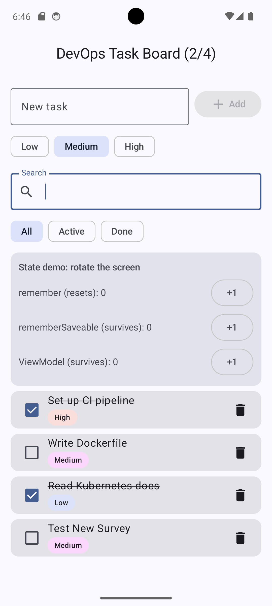
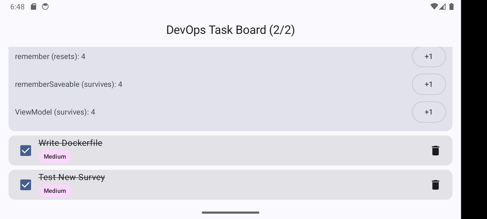

# DevOps Task Board — Jetpack Compose (Task 2)

Android app written in Kotlin with Jetpack Compose, Material 3 and a `ViewModel`.
A small task tracker for DevOps learning goals.

## Features
- Add tasks with a priority (Low / Medium / High)
- Mark tasks as done (checkbox) and delete them
- Search by title and filter All / Active / Done
- Progress counter in the top bar
- **State demo card**: three counters (`remember`, `rememberSaveable`, `ViewModel`) to show behaviour on rotation

## Architecture
| Layer | File |
|---|---|
| Data model | `Task.kt` |
| State + logic | `TaskViewModel.kt` (`StateFlow<TaskUiState>`) |
| UI | `ui/TaskScreen.kt`, `ui/Components.kt` |
| Entry point | `MainActivity.kt` |

Reusable composables: `PriorityBadge`, `TaskCard`, `AddTaskBar`, `SearchField`, `FilterRow`, `StateDemoCard`.

## remember vs rememberSaveable vs ViewModel
| | Survives recomposition | Survives rotation | Survives process death |
|---|---|---|---|
| `remember` | yes | **no** | no |
| `rememberSaveable` | yes | yes (saved in Bundle) | yes (small data) |
| `ViewModel` | yes | yes (kept in ViewModelStore) | no |

`remember` is for cheap local UI state, `rememberSaveable` for small user input (the draft text), `ViewModel` for screen state and business logic.

## Run
1. Android Studio (Koala or newer), JDK 17.
2. Open the project, wait for Gradle sync.
3. Start an emulator (API 26+) or connect a device, press **Run ▶**.

## Test
- Unit tests: `./gradlew test` (or right-click `TaskViewModelTest` → Run).
- Rotation: press `+1` on all three counters, rotate the device → only `remember` resets.

## Screenshots
| Main screen | After rotation |
|---|---|
|  |  |
